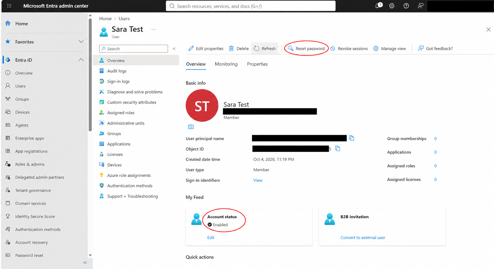
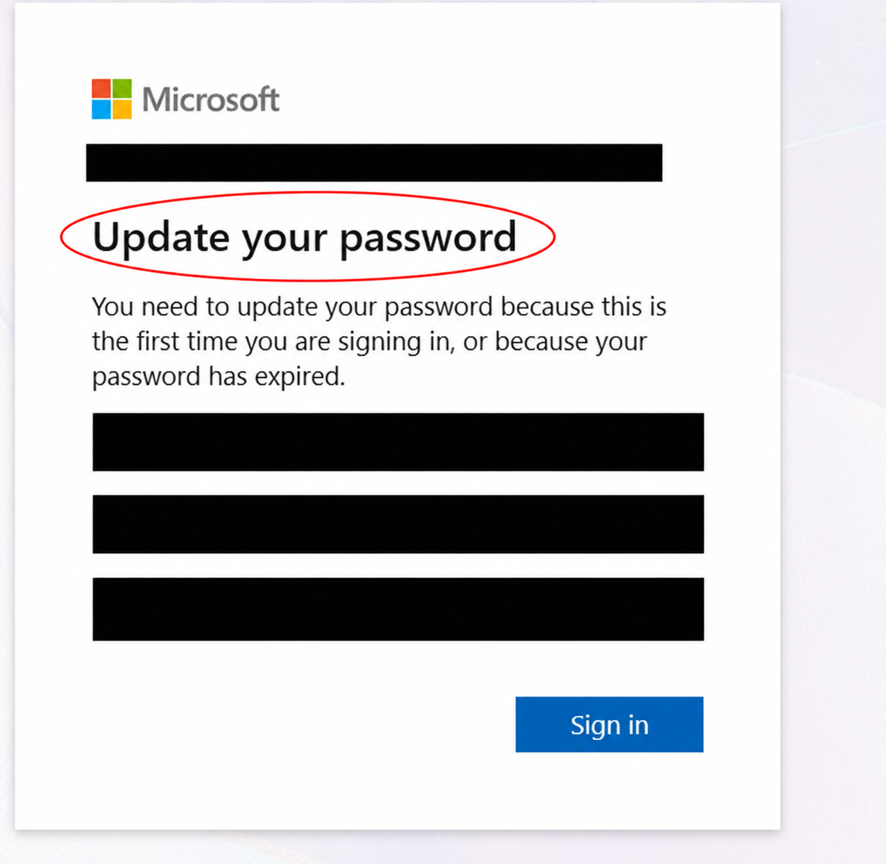
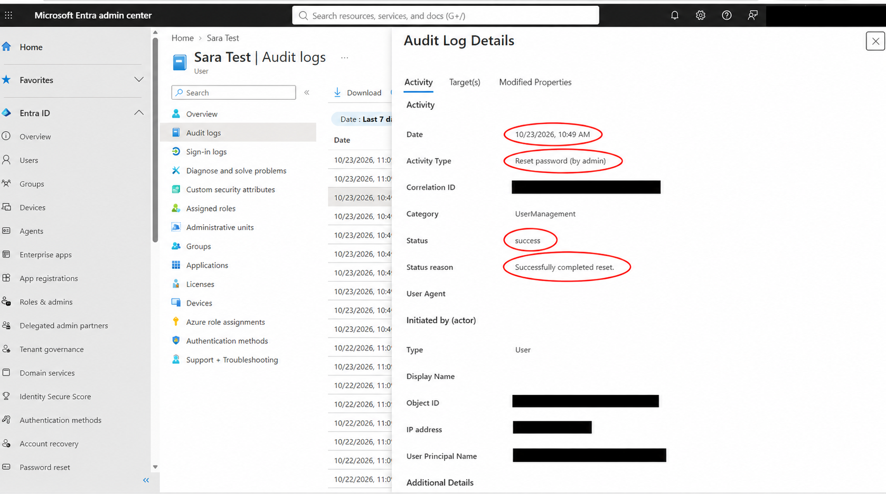
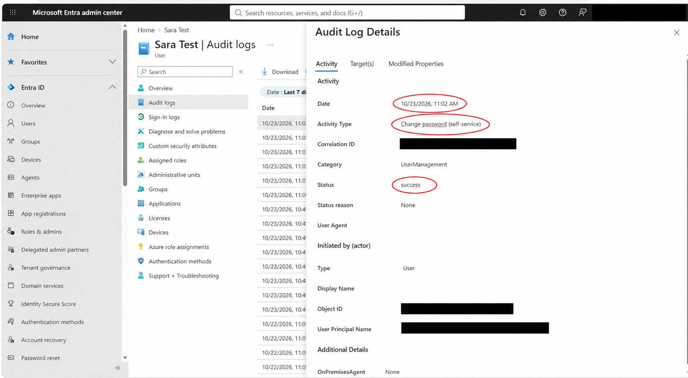
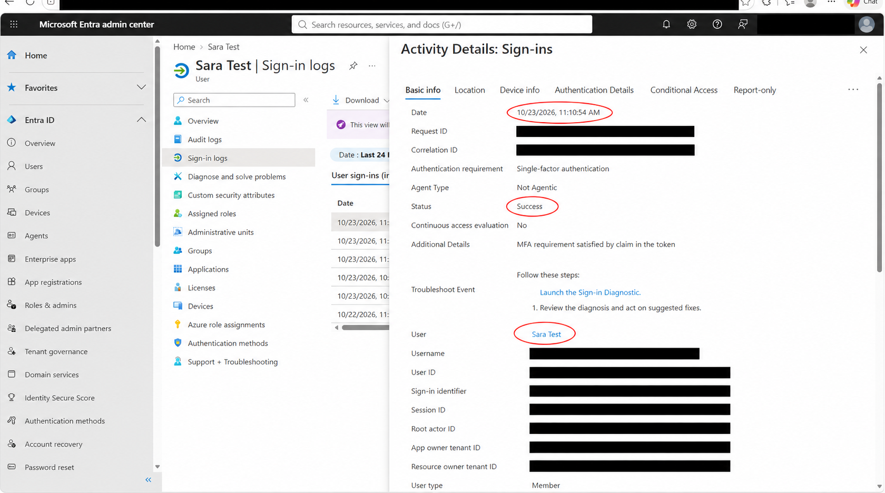

# Lab 02: Administrator Password Reset and User Password Change

## Objective
Practice a common IAM support workflow in Microsoft Entra ID: reset a test user's password, require a password update during sign-in, and verify the outcome through audit and sign-in logs.

## Environment
- Personal Microsoft Entra lab tenant.
- Fictional test user: Sara Test.
- Administrator account used to manage the test user.
- Lab date: October 23, 2026. Times below are as displayed in the portal.

## Work performed
1. Confirmed the test account was enabled and located **Reset password**.
2. Reset the password as an administrator and kept the temporary password private.
3. Signed in as the test user and encountered **Update your password**.
4. Set a new password. An earlier attempt was rejected; a subsequent password change succeeded.
5. Opened the signed-in account page and reviewed audit and sign-in records.

## Verified results
| Evidence | Result |
|---|---|
| Administrator reset audit, 10:49 AM | Reset password (by admin): success; Successfully completed reset. |
| User change audit, 11:02 AM | Change password (self-service): success. |
| Sign-in record, 11:10:54 AM | Sara Test: Success. |

The earlier rejected change displayed `PasswordDoesnotComplyFuzzyPolicy`. Its screenshot is not included in this package. The successful change is documented separately.

## Evidence
See [Screenshot index](SCREENSHOT-INDEX.md) for all five images.

## Skills practiced
- Administrator password reset and user account support.
- Password update workflow and troubleshooting a rejected password.
- Reading audit logs and distinguishing administrator resets from user changes.
- Reviewing sign-in status and preparing evidence with privacy redactions.

## Scope and limitations
This was a manual test-account exercise. It did not configure self-service password reset (SSPR) enrollment or recovery policies. The activity label **Change password (self-service)** records a user password change; it does not demonstrate a forgotten-password recovery flow.

The sign-in record displays **Single-factor authentication** and **MFA requirement satisfied by claim in the token**. It does not establish that a fresh MFA prompt occurred or independently identify which password was entered. The recorded sign-in occurred after the successful password-change audit event.

## Evidence handling
Screenshots were prepared with AI-assisted redaction and red annotations. Original captures should be retained privately. Emails, tenant details, passwords, and visible identifiers are covered in the included images. No temporary or new passwords are documented here.
