# Lab 03: Microsoft Entra ID Group Management and RBAC

## Objective
Practice security group membership management, direct directory role assignment, permission observations, audit review, and cleanup in a test tenant.

## Environment
- Microsoft Entra admin center
- Administrator account for configuration and audit review
- Sara Test account for permission observations
- LAB03-Helpdesk: a cloud security group with Assigned membership
- Directory Readers: the directory role assigned directly to Sara

## Screenshot walkthrough

### 01. Create the helpdesk security group

I created LAB03-Helpdesk as a Security group with Assigned membership. This provides a dedicated group for practicing manual membership changes.

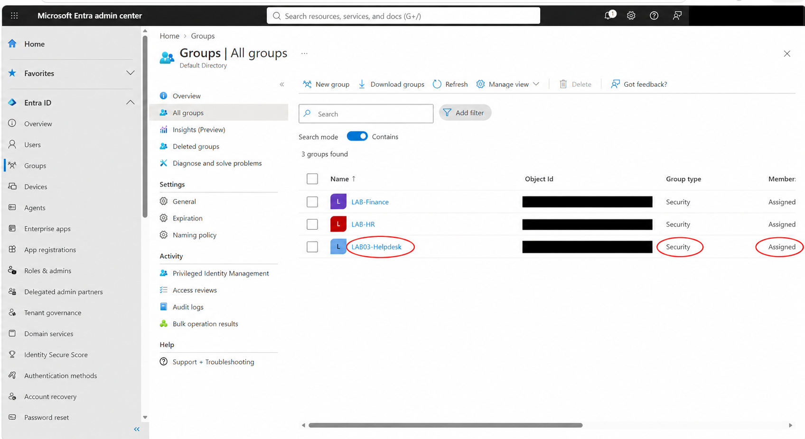

### 02. Record the empty group

Before adding Sara, I confirmed the group had zero members. This establishes the starting state for the membership test.

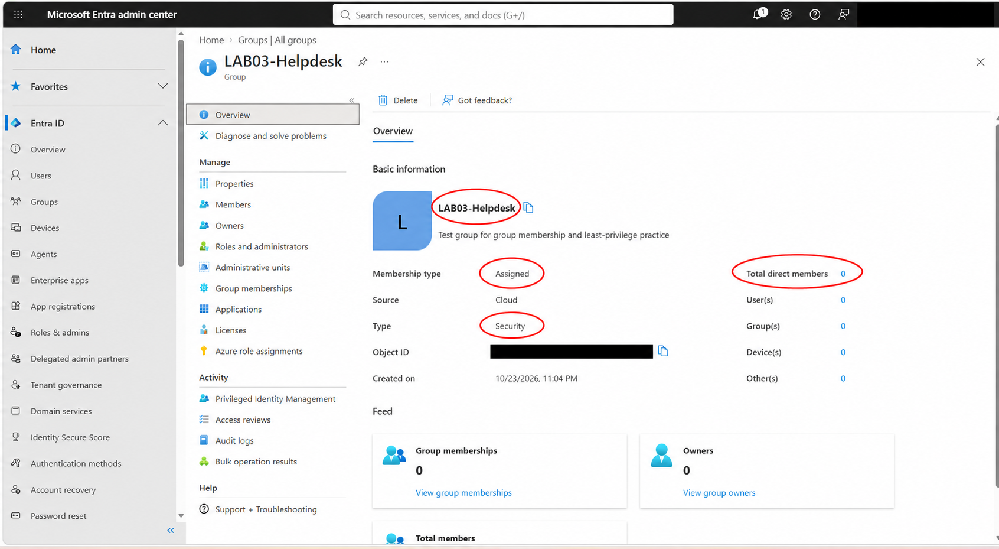

### 03. Confirm the member count

After adding Sara Test, the group overview showed one direct member and one user. The next screenshot identifies that member.

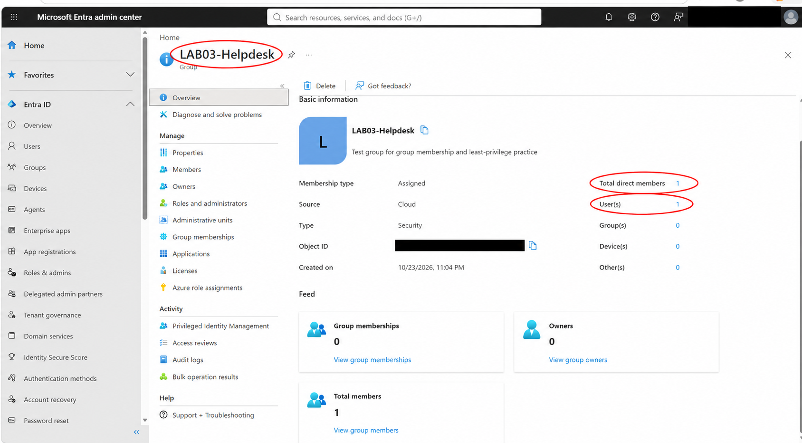

### 04. Verify Sara’s direct membership

The Direct members list shows Sara Test as a User. This confirms that the test account was added to LAB03-Helpdesk.

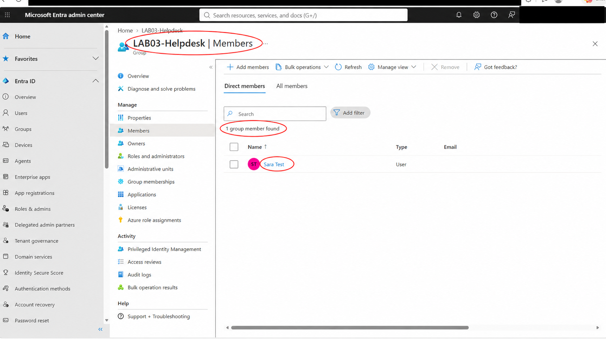

### 05. Check Sara’s initial directory roles

Sara’s Assigned roles page showed no directory roles before the assignment. Group membership and directory role assignments were tracked separately.

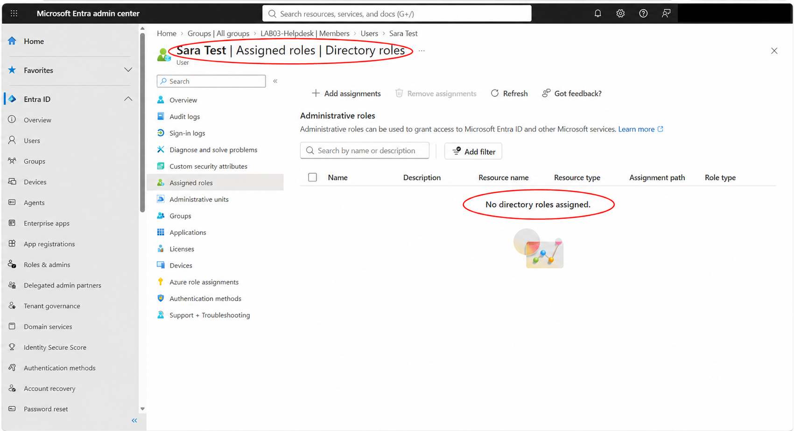

### 06. Assign Directory Readers directly

I assigned Directory Readers directly to Sara and confirmed the Direct assignment type. This role was assigned to the user, not through LAB03-Helpdesk.

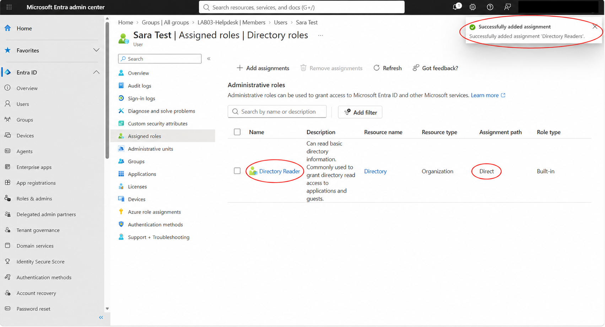

### 07. Observe the user profile controls

In Sara’s session, a user profile was visible while Edit properties, Delete, and Revoke sessions appeared disabled. This records the UI behavior; I did not test backend write requests. Some profile reads can also be available through default directory permissions.

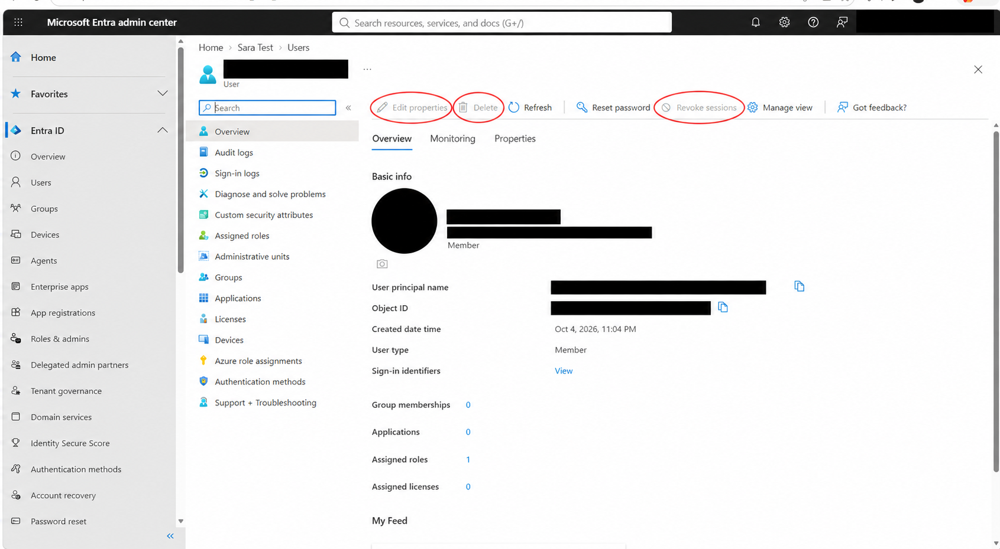

### 08. Record the audit log access denial

Opening audit logs in Sara’s session displayed “You don’t have access” and error 401. I recorded this as an observed access boundary for that session.

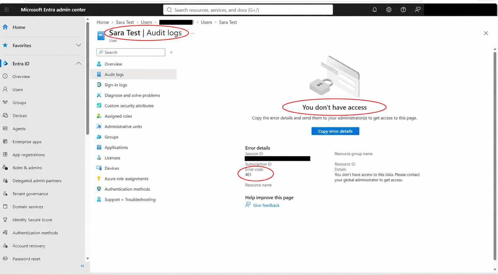

### 09. Review the role-assignment audit event

Using the administrator session, I reviewed the Add member to role event. The RoleManagement category and Success status provide an audit record of the assignment operation.

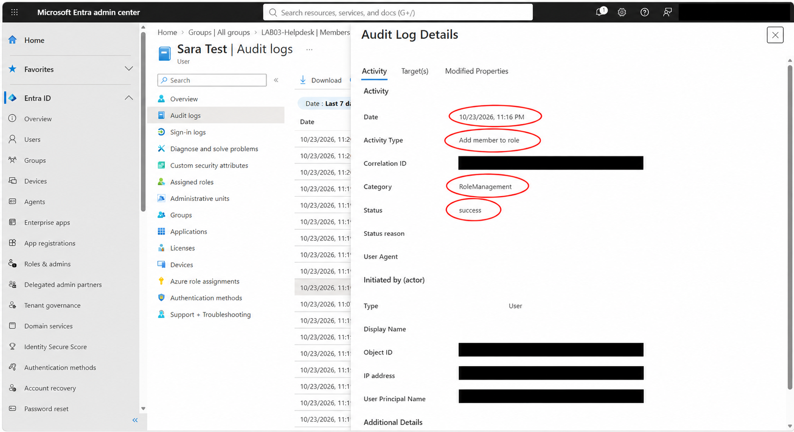

### 10. Inspect the audit targets

The audit event lists User and Role targets. Identifiers are redacted and display-name fields are blank, so this image is interpreted alongside the direct-assignment screenshot rather than used alone to identify Directory Readers.

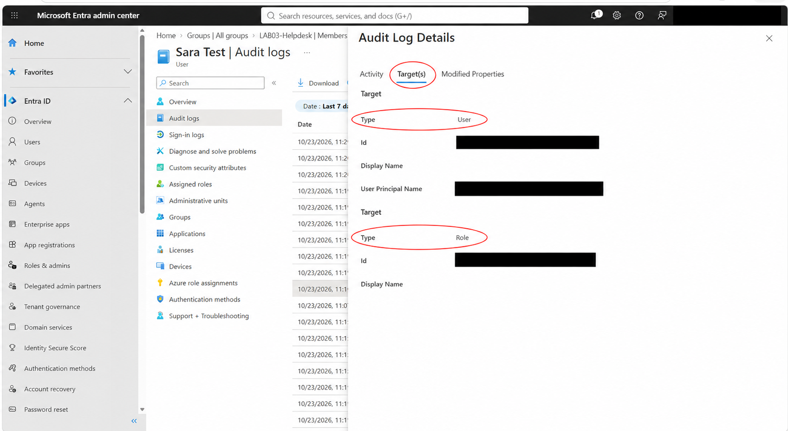

### 11. Remove the directory role

I removed Sara’s Directory Readers assignment and confirmed that the Assigned roles list was empty. This records removal of the assignment; a fresh permission test after removal was not performed.

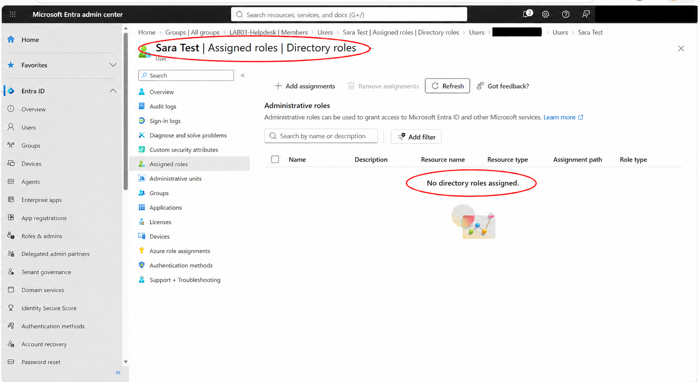

### 12. Verify the role-removal audit event

The administrator audit view shows Remove member from role with a Success status. This supports the role cleanup recorded in the preceding screenshot.

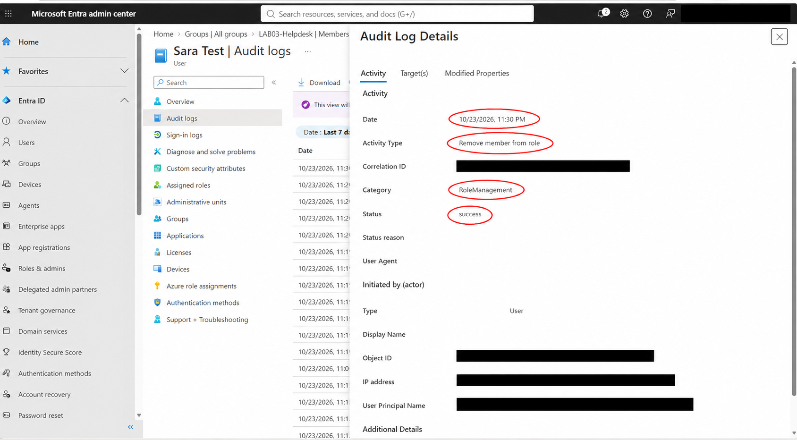

### 13. Check the group count after role removal

LAB03-Helpdesk still showed one direct user member after the directory role was removed. Removing the direct role did not automatically remove group membership.

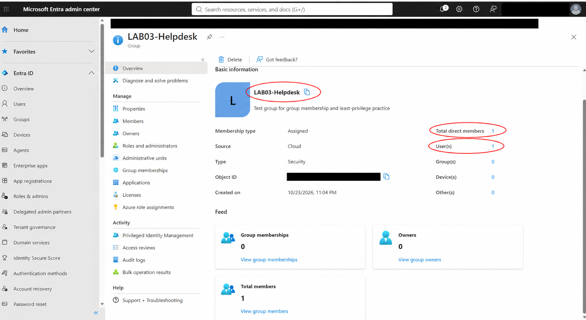

### 14. Identify the remaining group member

Sara Test remained in the group’s Direct members list after role removal. This identifies the member behind the overview count and demonstrates the independent membership state.

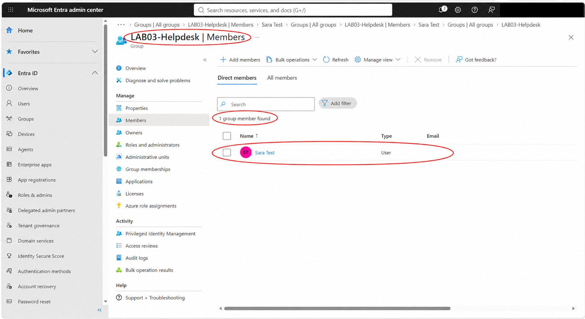

### 15. Clean up the group membership

I removed Sara from LAB03-Helpdesk. The success notification and zero-member list confirm the group membership cleanup. The empty lab group was retained.

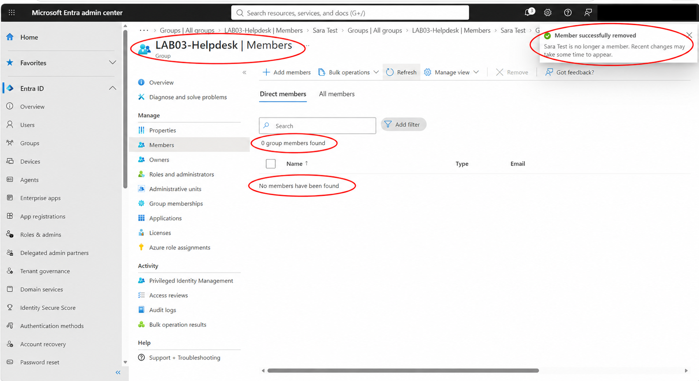

## Work completed
1. Created LAB03-Helpdesk and recorded its initial empty membership.
2. Added Sara Test and confirmed the direct member list and member count.
3. Recorded Sara’s initial absence of directory roles.
4. Assigned Directory Readers directly to Sara and confirmed the assignment type.
5. Used Sara’s session to inspect a user profile. Edit properties, Delete, and Revoke sessions appeared disabled.
6. Attempted to open audit logs in Sara’s session and recorded the access-denied page with error 401.
7. Used the administrator session to review the successful role-assignment audit event and its User and Role targets.
8. Removed Directory Readers and confirmed that Sara had no assigned directory roles. Reviewed the successful removal audit event.
9. Confirmed Sara still belonged to LAB03-Helpdesk after the role was removed.
10. Removed Sara from LAB03-Helpdesk and confirmed the successful removal and empty member list.

## Results
| Check | Observed result |
|---|---|
| Add group member | Sara listed as a direct member |
| Assign directory role | Directory Readers shown as a direct assignment |
| Inspect user profile | Profile visible; selected management controls disabled |
| Open audit logs as Sara | Access denied, error 401 |
| Remove directory role | Assigned roles list empty; removal audit event successful |
| Check independent group membership | Sara remained a member after role removal |
| Clean up membership | Zero group members and successful removal message |

## What this lab demonstrates
Group membership and a direct directory role assignment can be managed independently. Removing Sara’s direct role did not remove her group membership. The lab also records an observed permission boundary and audit evidence for administrative role changes.

## Scope and evidence limits
- The group was an ordinary security group. This lab used direct user role assignment; it did not assign Directory Readers through the group.
- This is Microsoft Entra directory role practice. Azure subscription/resource RBAC, PIM, application SSO, and automated provisioning were not configured.
- Default directory permissions can permit some profile reads. Profile visibility alone does not prove the role caused that access.
- Disabled UI controls were observed; backend write requests were not tested. The audit log denial records the behavior of that session, not a comprehensive permissions test.
- No fresh permission test after role removal is claimed. Cleanup is evidenced by the assigned-roles list, audit event, and empty group membership.
- Screenshots were prepared with AI-assisted redaction and red callouts. Keep original captures privately for verification. Redacted audit target identifiers and blank display-name fields do not independently identify the role; use the assignment screenshot alongside the audit sequence.

## Final state
Sara’s Directory Readers assignment and LAB03-Helpdesk membership were removed. The empty lab group was retained.

## Evidence
See [Screenshot index](SCREENSHOT-INDEX.md) for all 15 numbered screenshots.
