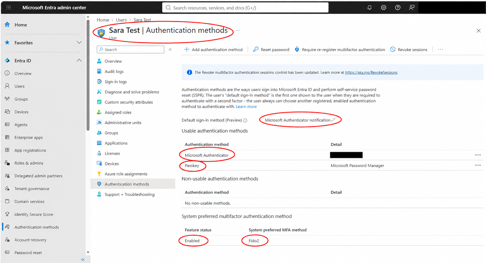
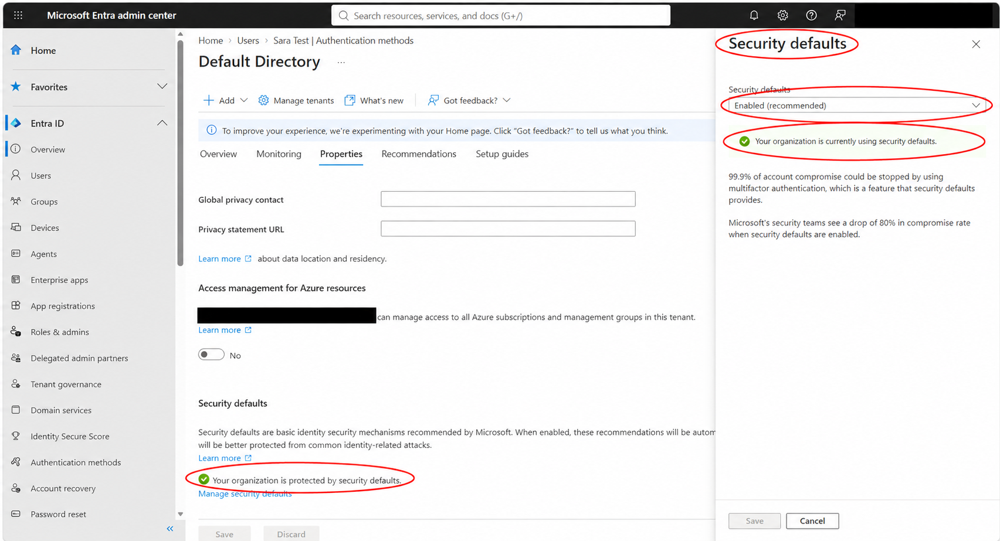
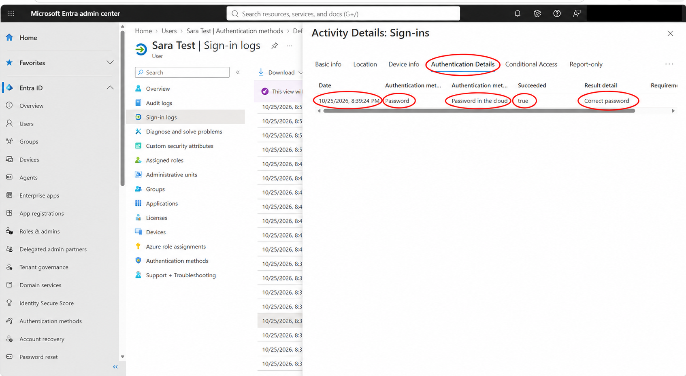
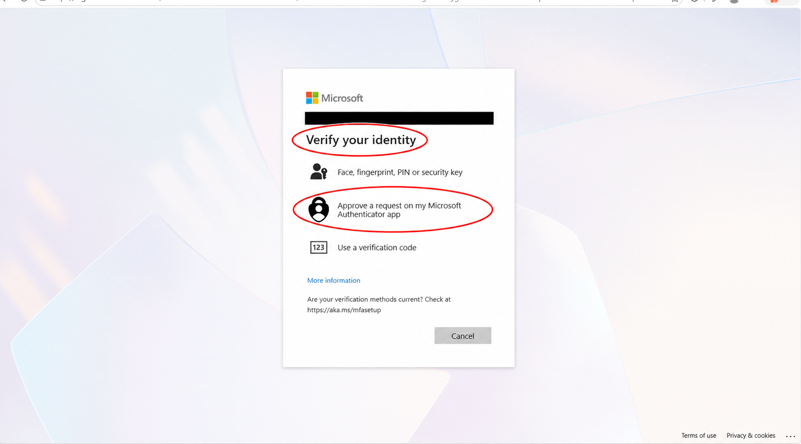
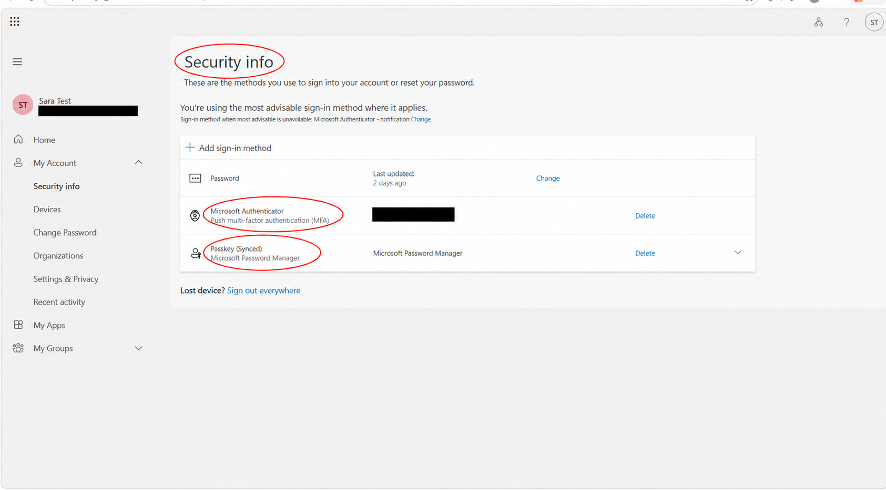
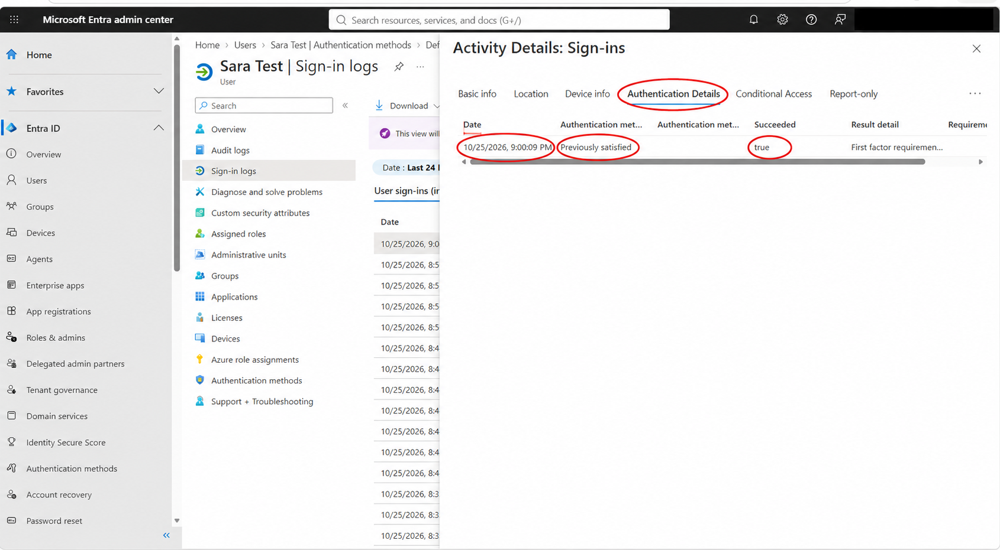
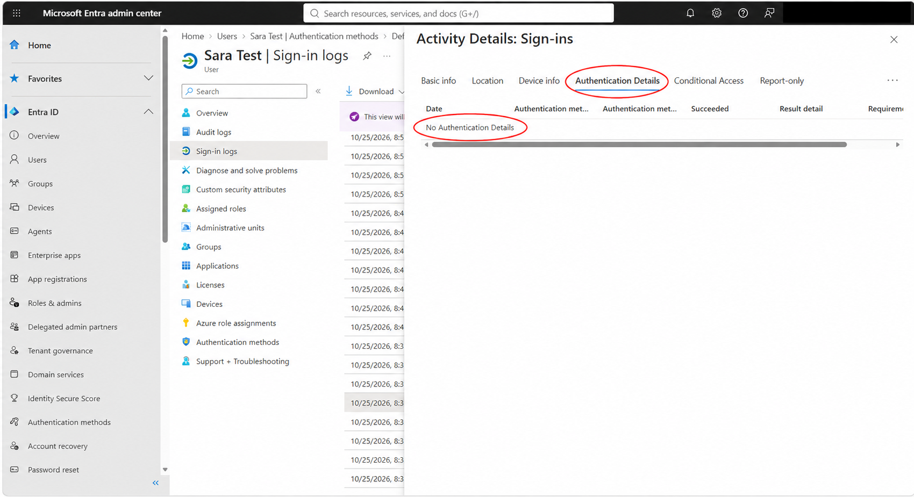

# Lab 04 Microsoft Entra ID MFA and Sign-in Evidence

## Objective
Inspect existing MFA registration and Security defaults, test sign-in and Security info verification, and interpret authentication evidence without overstating the results.

## Environment and scope
Personal Microsoft Entra ID lab tenant, administrator session, and Sara Test user session. Authenticator and a passkey were already registered. No methods were added, removed, or reset, and Security defaults remained enabled.

## Results
- Recorded existing Authenticator and passkey registration and enabled Security defaults.
- Confirmed a successful password authentication event.
- Observed an identity-verification prompt when accessing Security info.
- Approved an Authenticator request on my phone and accessed Security info, as a participant observation.
- Reviewed events showing Previously satisfied or no authentication details. A fresh Authenticator approval was not independently confirmed in the captured logs.

## Screenshot walkthrough

### 01 Review existing authentication methods

Sara already had Microsoft Authenticator and a passkey registered. The page also displayed system-preferred MFA as Enabled with Fido2 preferred. Registration alone does not prove a particular sign-in used MFA.

### 02 Inspect Security defaults

Security defaults was already enabled in the tenant. I recorded the existing state and left it unchanged; I did not create a Conditional Access policy or enable a new MFA policy.

### 03 Inspect password authentication

The 8:39:24 PM event recorded Password, Password in the cloud, Succeeded true, and Correct password. This confirms a password check, not a fresh MFA approval.

### 04 Open Security info and review verification options

Opening Security info in Sara’s session displayed Verify your identity, offering Authenticator approval, passkey/security key, or a verification code. This screenshot records the options before verification, not a completed approval.

### 05 Access Security info

I selected Authenticator approval and approved the request on my phone, then accessed Security info. The page lists Authenticator Push MFA and a synced passkey. The approval is my reported observation; this page alone does not independently prove the authentication step.

### 06 Review a previously satisfied event

The 9:00:09 PM event displayed Previously satisfied and Succeeded true. Its result detail is truncated in the screenshot. This does not independently show a fresh Authenticator approval or establish that this event corresponds to the earlier phone approval.

### 07 Record an evidence limitation

Another inspected event displayed No Authentication Details. The image does not establish its exact event identity, success or failure, or whether MFA occurred. It is included only as supporting evidence of the limited details available in that view.

## Interpreting the logs
An earlier event reviewed during this exercise showed Single-factor authentication with the additional detail MFA requirement satisfied by claim in the token. That detail was transcribed during the exercise; it is not visible in the packaged authentication-detail screenshots. Microsoft explains that an event can display Single-factor when a previous MFA claim is accepted, and that Security defaults prompts ordinary users for MFA when necessary rather than at every sign-in. A password row, a registration page, or an empty details view alone cannot establish fresh MFA completion.

The exact reason the inspected events did not show the reported phone approval remains unresolved. This lab does not claim a proven MFA failure, a confirmed fresh MFA log entry, or a verified policy cause for the Security info prompt.

## Lessons learned
- Distinguish registered methods, policy settings, observed user actions, and event-level evidence.
- Read authentication details alongside the sign-in requirement rather than relying on a single label.
- Document incomplete evidence and retain the limits of each screenshot.
- Avoid resetting working authentication methods merely to change a log label.

## Final state
Security defaults remained enabled. Sara’s existing Authenticator and passkey methods were retained. No cleanup of newly created methods or policies was needed because none were created.

## Privacy and evidence handling
Screenshots were prepared with AI-assisted redaction and red callouts. Personal identifiers and device details were hidden. Original captures should be retained privately for verification. Passwords, QR setup secrets, and verification codes are not included.

## References
- [Microsoft MFA event reporting](https://learn.microsoft.com/en-us/entra/identity/authentication/howto-mfa-reporting)
- [Microsoft Security defaults](https://learn.microsoft.com/en-us/entra/fundamentals/security-defaults)
- [Screenshot index](SCREENSHOT-INDEX.md)
