# Lab 05 — Microsoft Entra ID SAML SSO and Application Access

## Overview

Connected the Microsoft Entra SAML Toolkit sample application to Microsoft Entra ID, assigned a test user, validated SSO, investigated an account-session mismatch, and demonstrated that removing an application assignment blocks a new sign-in. This was a personal lab in a test tenant.

## Skills practiced

- Enterprise application onboarding and SAML federation configuration
- Entity ID, Assertion Consumer Service (ACS) URL and SP-initiated login URL
- Identity provider URLs, signing certificate and Name ID mapping
- Direct application assignment and assignment-required access control
- Sign-in log investigation and browser session troubleshooting
- Positive and negative access testing with documented evidence

## Environment and configuration

| Item | Configuration |
|---|---|
| Identity provider | Microsoft Entra ID |
| Sample service provider | Microsoft Entra SAML Toolkit |
| Enterprise application | LAB05-SAML-SSO |
| Test user | Sara Test |
| Entity ID | `https://samltoolkit.azurewebsites.net` |
| Reply URL / ACS | Toolkit-generated `/SAML/Consume/<connection-id>` URL |
| Sign on URL | Toolkit-generated `/SAML/Login/<connection-id>` URL |
| Name ID format | Email address |
| Name ID source | `user.userprincipalname` |
| User access | Direct assignment; Default Access |
| Assignment required | Yes (observed in Properties) |
| Test browser | Microsoft Edge Guest |

The Toolkit’s local registration password is separate from Sara’s Entra password. The SSO test used the Microsoft sign-in flow. Security defaults remained enabled. No Conditional Access policy was created in this lab.

## Validation results

| Test | Observed result | Evidence |
|---|---|---|
| Sara assigned; Microsoft sign-in in Edge Guest | Returned to Toolkit as Sara; Entra recorded Success for LAB05-SAML-SSO | Screenshots 9–11 |
| Sara unassigned; new Guest session and new SSO attempt | Blocked with AADSTS50105 because access was not assigned | Screenshots 12–13 |
| Early attempt using administrator session | Entra administrator sign-in succeeded; Toolkit processing failed for the intended test flow | Screenshot 8 and troubleshooting notes |

The failed event was not visible in the sign-in logs when checked after several refreshes. The negative test is supported by the empty assignment list and Microsoft’s explicit AADSTS50105 error page; a failed-log screenshot is not claimed. Final observed state: Sara remains unassigned from this sample application. No post-removal session revocation or restoration test was performed.

## Walkthrough and screenshot evidence

Personal account details and visible identifiers have been redacted; red outlines highlight the evidence. Images are annotated copies of captured lab screens. Raw authentication responses, passwords and certificate files are not included.

### 01. Enterprise application created

Added the Microsoft Entra SAML Toolkit gallery application and named it LAB05-SAML-SSO.

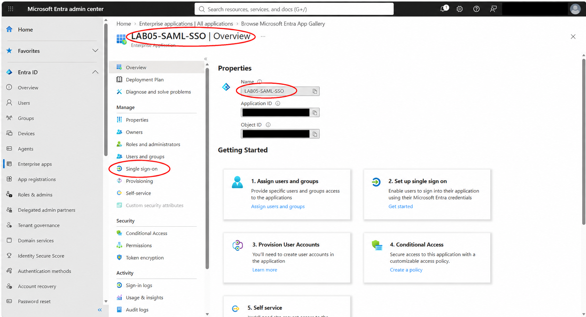

### 02. SAML selected before configuration

Selected SAML as the sign-on method. The required connection fields were initially incomplete.

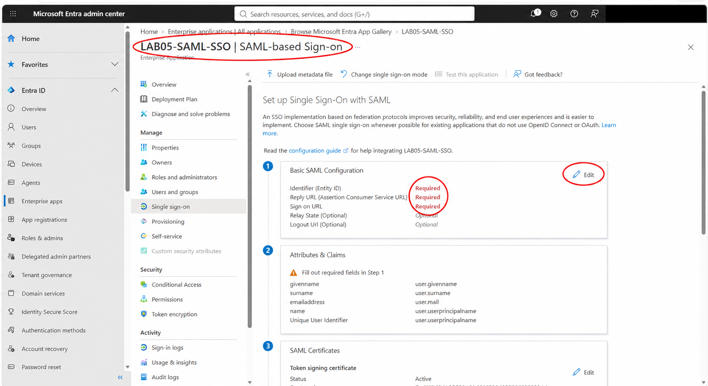

### 03. Initial SAML settings

Saved the initial Toolkit Entity ID, reply URL and sign-on URL. These initial endpoints were subsequently replaced with the connection-specific endpoints in screenshot 6.

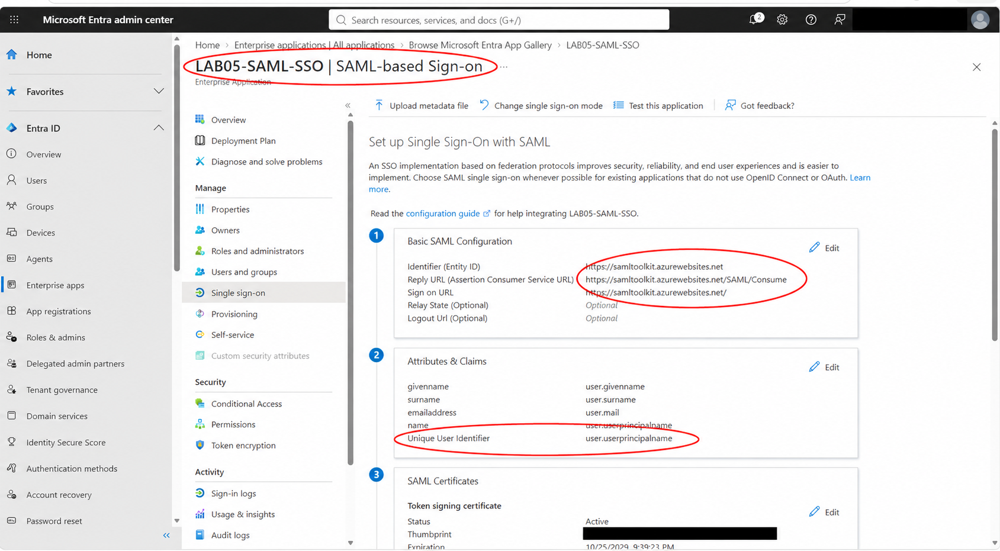

### 04. Certificate and identity provider settings

Reviewed the active signing certificate, downloaded Certificate (Raw), and copied the Entra Login URL, Microsoft Entra Identifier and Logout URL into the Toolkit configuration. Tenant-specific values are redacted.

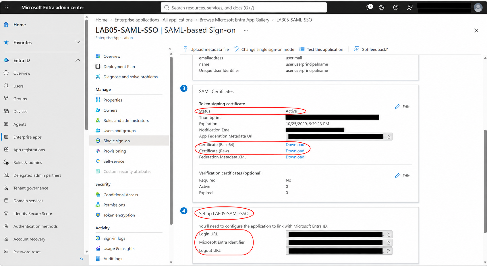

### 05. Toolkit connection created

Registered a Toolkit test account matching Sara’s Entra username, configured the identity provider URLs and uploaded the public signing certificate. The Toolkit generated a connection-specific SP-initiated login URL and ACS URL.

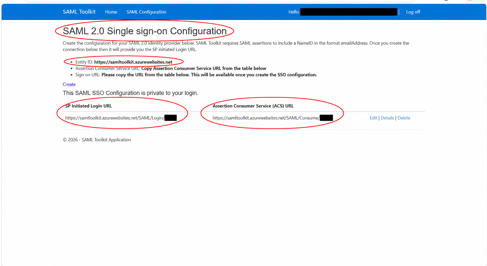

### 06. Connection-specific Entra endpoints

Replaced the initial Reply URL with the generated ACS URL and the Sign on URL with the generated SP-initiated login URL. Kept the Entity ID unchanged. Name ID was checked separately: Email address format with user.userprincipalname as its source.

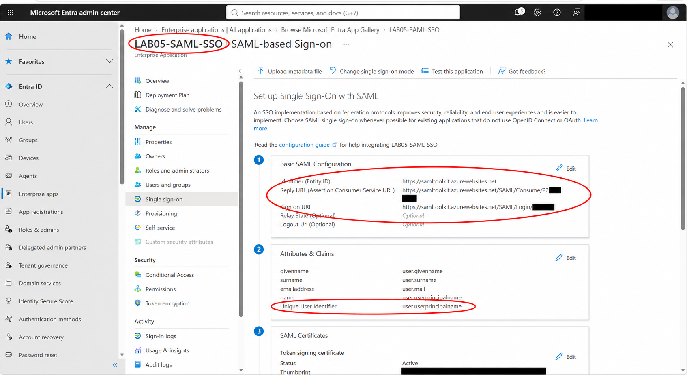

### 07. Sara assigned to the application

Assigned Sara Test directly to the enterprise application with Default Access. The tenant plan did not support group assignment, so this lab used an individual assignment.

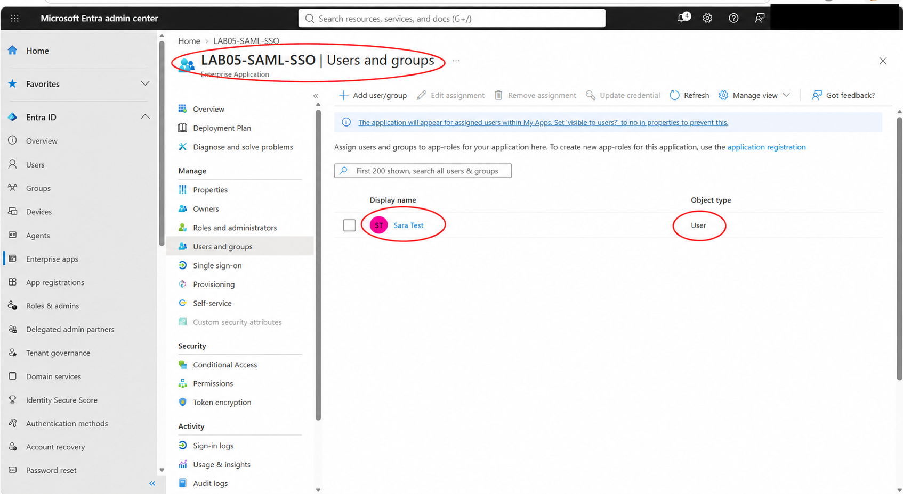

### 08. Troubleshooting an administrator session

An early attempt used an existing administrator Microsoft session. This event shows Entra success for that administrator, while the Toolkit could not complete sign-in for the expected test account. This is troubleshooting evidence, not Sara’s successful event. Used a fresh Microsoft Edge Guest session to select Sara explicitly; no certificate or Name ID change was needed.

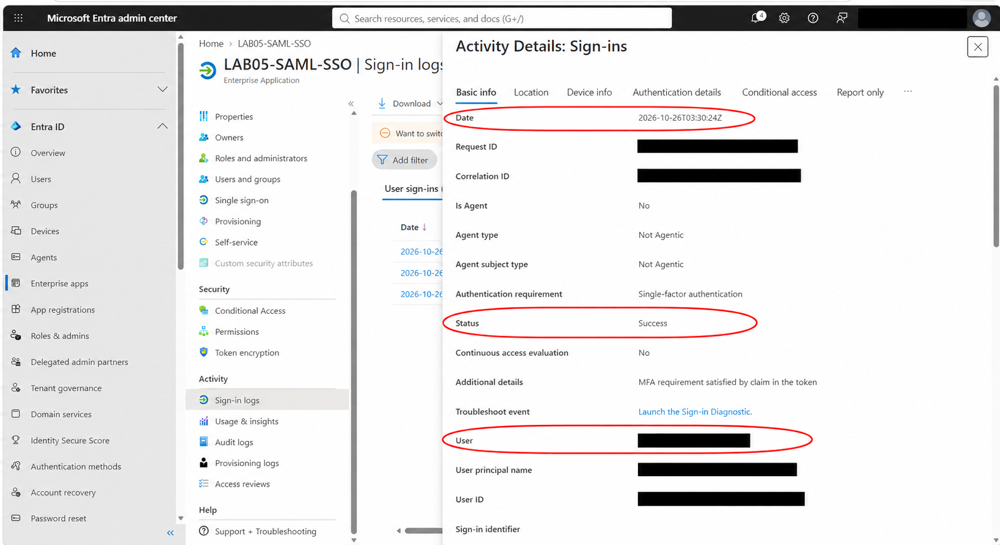

### 09. Sara reaches the Toolkit through SSO

In an isolated Edge Guest session, opened the connection-specific SAML login page, selected Log in, authenticated as Sara on Microsoft’s page and returned to the Toolkit home page with Sara’s greeting. Together with screenshots 10–11, this documents the successful SSO test.

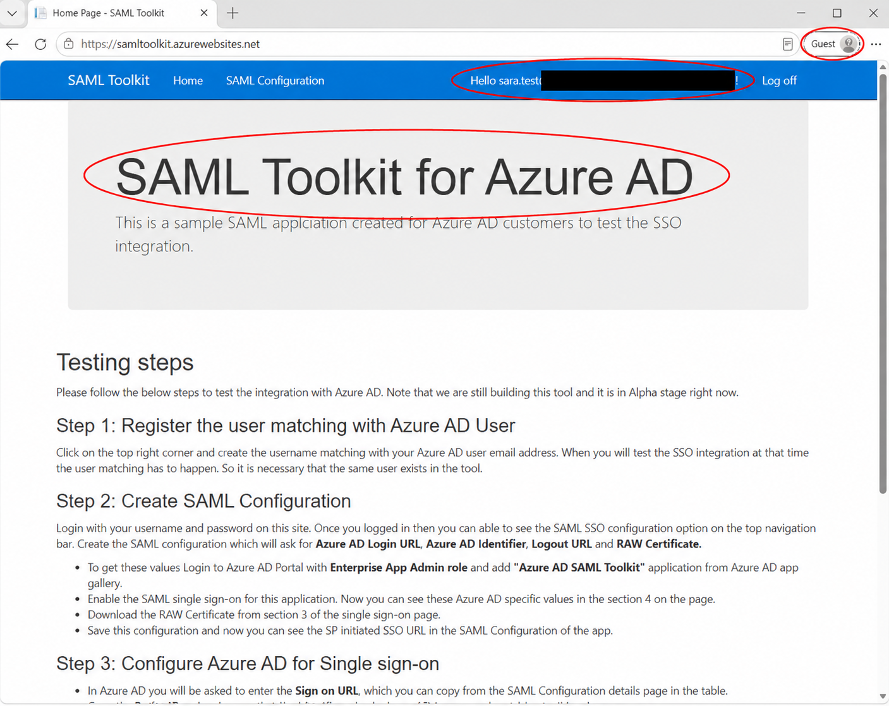

### 10. Sara’s successful sign-in event

Entra recorded Sara Test with Status: Success at 11:35:20 PM on October 25, 2026. The event reports Single-factor authentication and MFA requirement satisfied by claim in the token. This does not establish that a fresh MFA prompt occurred during this SSO test.

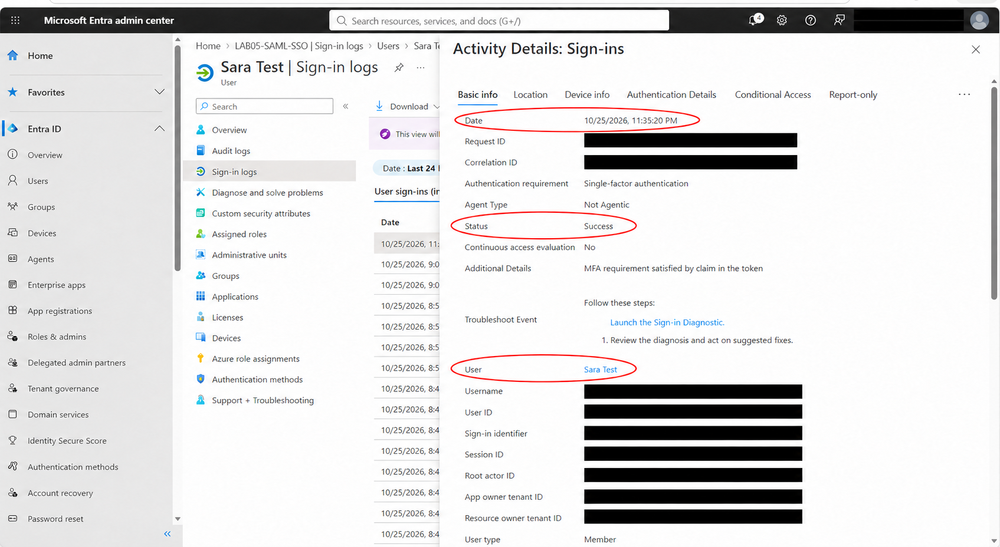

### 11. Application details in the same event

The same event identifies LAB05-SAML-SSO as the application, Browser as the client and Microsoft Entra ID as token issuer. The application name ties the successful event to this integration.

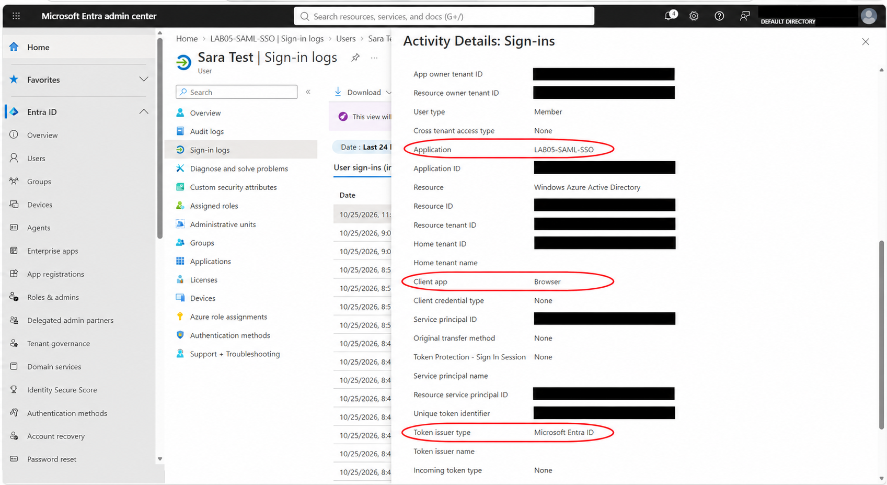

### 12. Sara’s assignment removed

Removed Sara’s application assignment. The application list then showed No application assignments found. Assignment required was verified as Yes in Properties before testing. Sara’s directory account was retained.

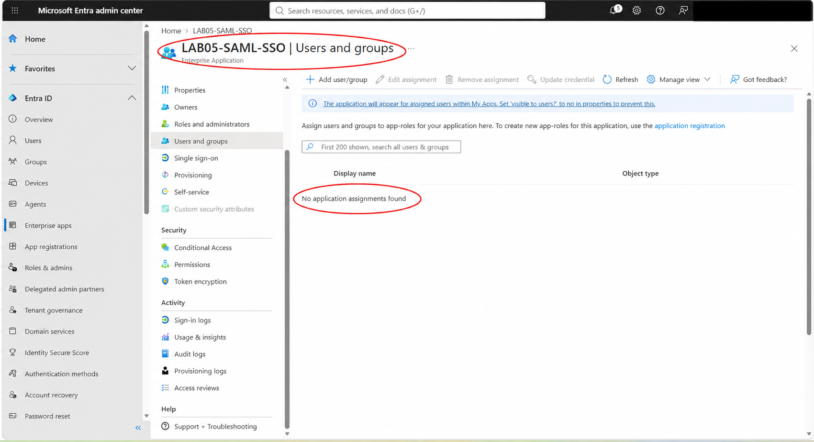

### 13. Fresh sign-in blocked after removal

Closed all Guest windows and started a new Guest session, then attempted SAML sign-in as Sara. Microsoft returned AADSTS50105 at 11:52:17 PM on October 25 (03:52:17 UTC October 26), explicitly stating the user lacked assigned access. This validates blocking of a new sign-in; termination of an existing application session was not tested.

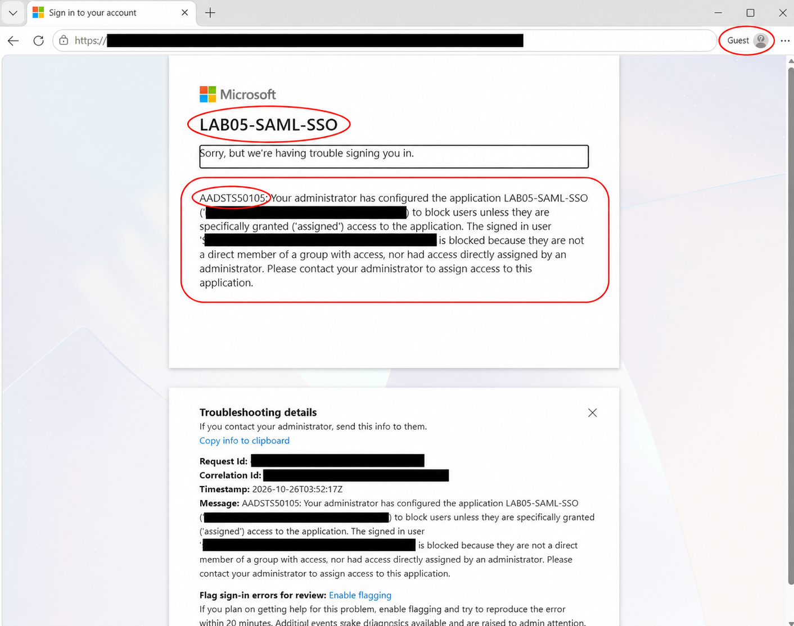

## What I learned

Authentication and application authorization are separate checks: Sara could authenticate to Entra, but removing her required application assignment prevented a new SSO sign-in. Browser sessions can silently select the wrong Microsoft identity, so checking the actual user and timestamp in logs was essential. A successful Entra event alone does not prove the service provider completed its processing; the returned application page provided additional confirmation.

## References

- [Microsoft: Configure SAML Toolkit SSO](https://learn.microsoft.com/en-us/entra/identity/saas-apps/saml-toolkit-tutorial)
- [Microsoft: Customize SAML claims and Name ID](https://learn.microsoft.com/en-us/entra/identity-platform/saml-claims-customization)

## Portfolio directory entry

Add this row to the repository’s main lab table:

| 05 | [SAML SSO and Application Access](Lab-05-SAML-SSO/) | SAML configuration, certificates, direct application assignment, SSO validation, session troubleshooting, and blocked-access testing |
