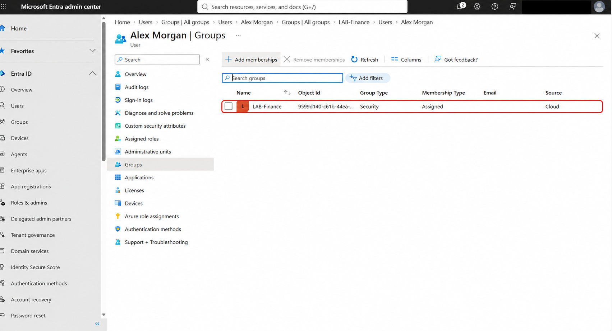
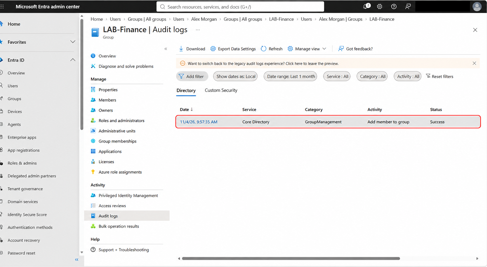
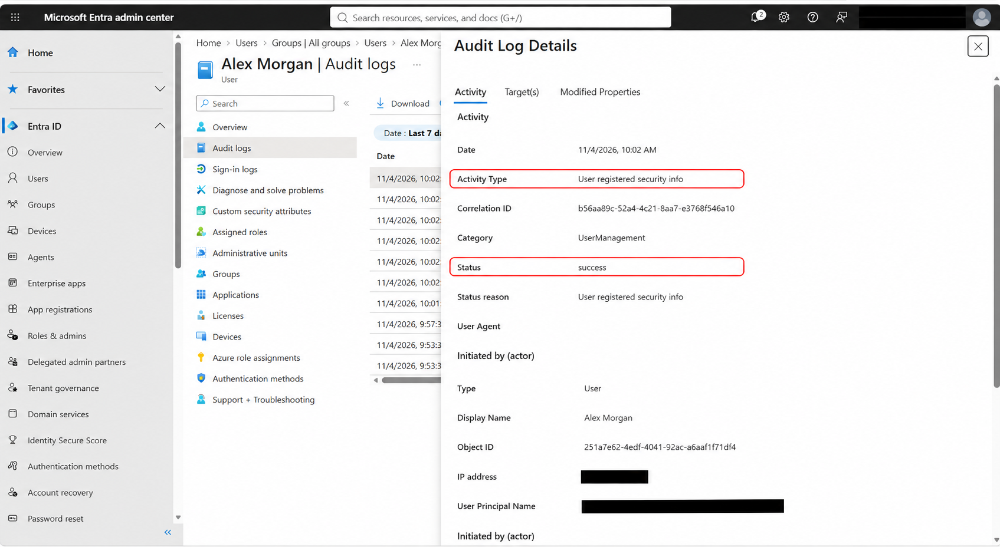
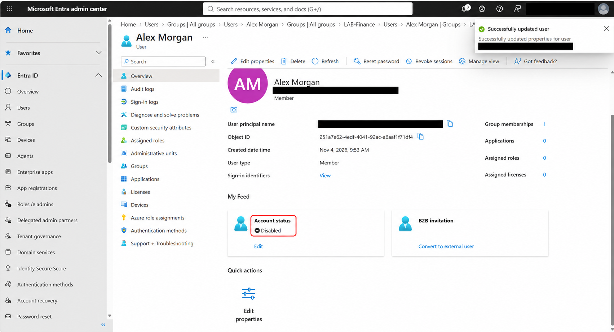
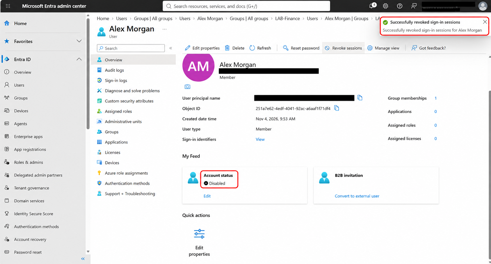
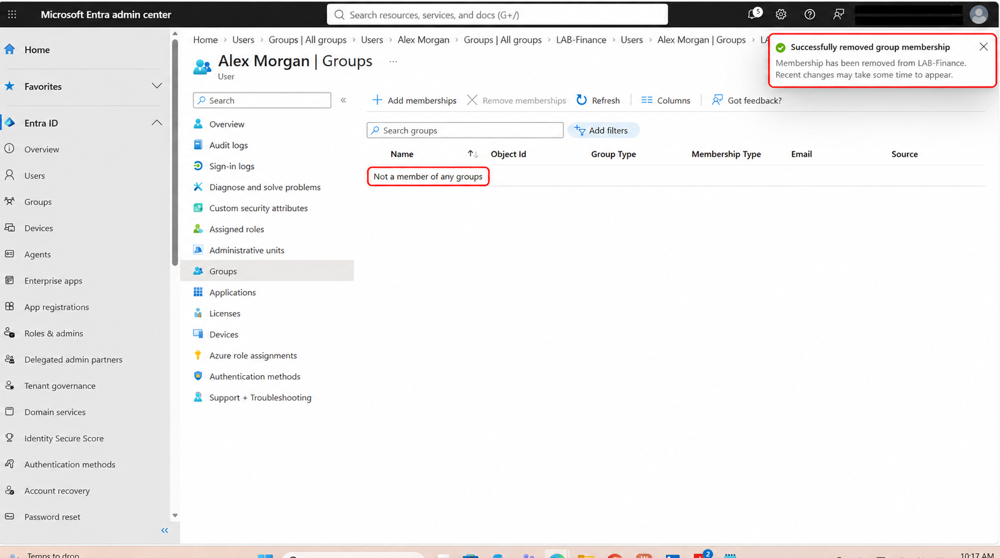

# User Provisioning and Deprovisioning in Microsoft Entra ID

**Author:** Soraya Zarangwal  
**Completed:** November 4, 2026  
**Environment:** Personal Microsoft Entra ID lab tenant  
**Scope:** Manual provisioning and deprovisioning of a fictional employee

## Overview

This lab demonstrates the lifecycle of a fictional Finance employee, Alex Morgan: creating an account, assigning department group membership, registering Microsoft Authenticator, testing sign-in, and removing access when the employee leaves.

The goal was to practice identity administration and verify changes using account settings, group membership, audit records, and browser behavior.

## Scenario

| Attribute | Lab value |
|---|---|
| Employee | Alex Morgan (fictional) |
| Department | Finance |
| Job title | Finance Assistant |
| Account type | Internal member |
| Department security group | LAB-Finance |
| Administrator roles assigned to employee | None |

No application or resource permissions were configured for LAB-Finance during this lab. Membership demonstrates department-based access assignment structure; it does not, by itself, prove access to a Finance application.

## Tools and skills

- Microsoft Entra admin center
- User and security-group administration
- Microsoft Authenticator registration
- Account disabling and session revocation
- Audit-log review and validation
- Least-privilege principles and technical documentation

## 1. Onboarding: create the employee account

I created Alex Morgan as an internal member using the lab tenant domain, enabled the account, and entered the Finance department and Finance Assistant job title. I used an automatically generated temporary password and kept credentials out of the public documentation.

Alex received no administrator roles. This maintained separation between the employee account and the account used to administer the lab.

## 2. Assign and verify Finance membership

I added Alex to the LAB-Finance security group and refreshed the membership list to verify the result. The group appeared with an Assigned membership type and Cloud source.

I then reviewed LAB-Finance's audit logs. The log showed an **Add member to group** event with **Success**, dated November 4, 2026, at 9:57:35 AM in the portal's local display. The group membership screen separately corroborated Alex's membership. The captured audit-list image does not show the event's Target(s) details.

## 3. Register Authenticator and test sign-in

In a separate browser session, I signed in as Alex using the temporary credentials and completed the prompted setup. Microsoft displayed **Authenticator Added**, and the My Account page displayed **Welcome back, Alex Morgan**.

I reviewed an audit event showing **User registered security info** with **success**, initiated by Alex Morgan. These observations demonstrate successful security-information registration and account sign-in. They do not establish that every application or sign-in is protected by an MFA enforcement policy.

The original Authenticator confirmation and My Account screenshots are retained privately because they contain the lab tenant address; they are not included in this public package.

## 4. Offboarding: disable the account

To simulate an employee departure, I changed Alex's account to disabled and saved the update. The Overview page then displayed **Account status: Disabled**.

## 5. Revoke sign-in sessions

I selected **Revoke sessions** for Alex. The admin center displayed **Successfully revoked sign-in sessions for Alex Morgan**.

Session revocation complements disabling the account. A success notification confirms that the administrative action was accepted; it does not prove every existing application session ended instantly. Token lifetime and application session behavior can affect when access ends.

## 6. Remove department membership

I removed Alex from LAB-Finance. The portal confirmed successful removal and displayed **Not a member of any groups** on Alex's Groups page.

This verifies removal of the department group membership shown in the lab. It is not a claim that every possible application-level permission was assessed.

## 7. Check access after offboarding

During the post-offboarding browser check, Microsoft displayed:

> Your account has been locked. Contact your support person to unlock it, then try again.

The account picker also showed a remembered **Signed in** label. That label alone did not demonstrate current access. The corresponding failed sign-in log and error code were not captured, so the browser message cannot independently establish the exact failure cause or prove immediate termination of all existing sessions.

The original browser screenshot is retained privately because it contains the lab tenant address.

## Validation results

| Check | Observed result | Evidence |
|---|---|---|
| Employee account created | Alex existed as an internal member | Account overview |
| Department membership assigned | LAB-Finance listed | Screenshot 01 |
| Assignment audited | Add member to group: Success | Screenshot 02 |
| Security information registered | User registered security info: success | Screenshot 03; private Authenticator confirmation |
| Sign-in before offboarding | My Account welcomed Alex | Private browser screenshot |
| Account disabled | Account status: Disabled | Screenshot 04 |
| Session-revocation action | Success notification | Screenshot 05 |
| Department membership removed | Success; no groups listed | Screenshot 06 |
| Post-offboarding browser check | Account-locked message | Private browser screenshot; exact cause unconfirmed |
| Failed sign-in log | Not captured | Validation limitation |

## What I learned

- Provisioning includes both account creation and appropriate access assignment.
- Department group membership and administrator roles serve different purposes.
- Disabling an account, revoking sessions, and removing memberships are separate offboarding actions.
- Audit events help document changes, but event names and targets must be checked before drawing conclusions.
- A browser error is useful supporting evidence; sign-in logs are needed to investigate the precise authentication failure.
- Successful Authenticator registration does not automatically prove tenant-wide MFA enforcement.

## Scope and limitations

This was a manual cloud-account lifecycle lab. It did not implement HR-driven provisioning, SCIM, Lifecycle Workflows, scripting, application entitlement removal, device recovery, mailbox handling, or automated access reviews. Alex had no assigned licenses or administrator roles in the captured overview. The account was left disabled rather than deleted.

## Screenshot handling

The public images are AI-assisted redacted and annotated presentation copies of screenshots captured during the lab. Image processing can reproduce UI pixels; the private original captures remain the source evidence. Highlights identify observed results, and personal account details were hidden. Do not treat the presentation copies as forensic originals.

## References

- [Microsoft Learn: Create, invite, and delete users](https://learn.microsoft.com/en-us/entra/fundamentals/how-to-create-delete-users)
- [Microsoft Learn: Revoke user access](https://learn.microsoft.com/en-us/entra/identity/users/users-revoke-access)

## Portfolio summary

Completed a manual Microsoft Entra ID onboarding and offboarding lab covering employee account creation, Finance security-group assignment, Authenticator registration, audit review, account disabling, session revocation, and membership removal. Documented observed results and sign-in validation limitations.
