# Lab 07 — PowerShell IAM Automation with Microsoft Graph

This lab demonstrates an operator-run identity lifecycle workflow in Microsoft Entra ID: provision two test users from CSV, assign a security group, disable the accounts, request session revocation, remove group memberships, and verify the final state.

## Environment and scope

- PowerShell 7.6.9; Microsoft Graph Authentication, Users, Groups, and Users.Actions modules 2.41.2.
- Delegated access scoped to the PowerShell process.
- Requested scopes: `User.ReadWrite.All`, `GroupMember.ReadWrite.All`, and `User.RevokeSessions.All`.
- Two test identities: **LAB07 Jamie Lee** and **LAB07 Taylor Reed**.
- Existing static security group: **LAB-Finance**.

These delegated permissions still depend on tenant consent and the signed-in account's directory permissions. This lab did not assign directory roles or licenses to the test users.

## Workflow and observed results

| Step | Work performed | Evidence observed |
|---|---|---|
| Setup | Installed PowerShell 7 and four Graph modules | Version and module output |
| Authenticate | Connected to the intended tenant and checked context, identity and scopes | Delegated / Process context and successful `/me` response |
| Prepare input | Imported `new-users.csv` | Two Finance users with distinct job titles |
| Provision | Created both users using `New-MgUser` | Both reported Created; read-back showed AccountEnabled=True |
| Assign group | Added both users to LAB-Finance | Added results and separate membership verification=True |
| Offboard | Disabled both accounts and requested session revocation | Verified disabled; request completed=True for each |
| Remove membership | Removed each group membership reference | Verified not a member for each |
| Validate | Re-queried account state and group membership | AccountDisabled=True and FinanceMembershipRemoved=True for both |
| Disconnect | Ended the Graph connection | `Disconnect-MgGraph` output |

## Screenshot evidence

Detected personal account names, local user paths, tenant domains and directory identifiers are covered with opaque gray boxes. Red circles highlight selected success values. These are pixel-preserving presentation copies with overlays; no command or result text was regenerated. The full Lab 07 screenshot sequence includes initial setup problems and canceled authentication attempts as troubleshooting history. The final successful connection is the basis for subsequent work.

### PowerShell 7 verified

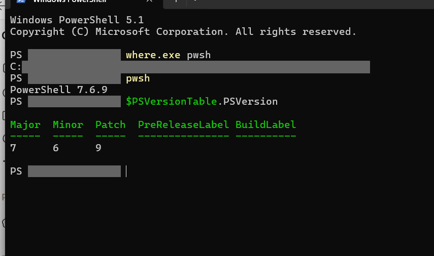

### Graph modules verified

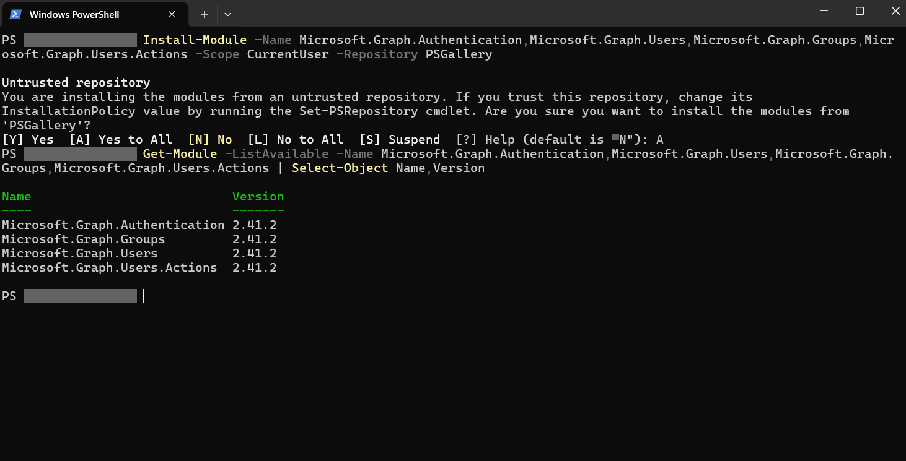

### Successful Graph connection

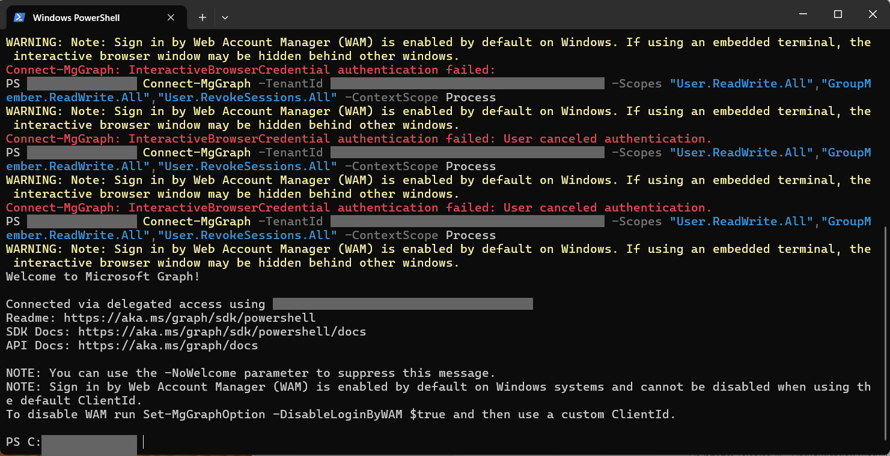

### Granted scopes inspected

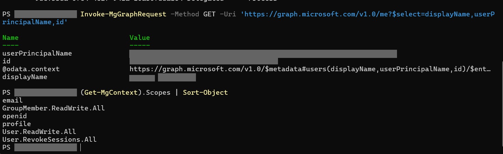

### CSV input prepared

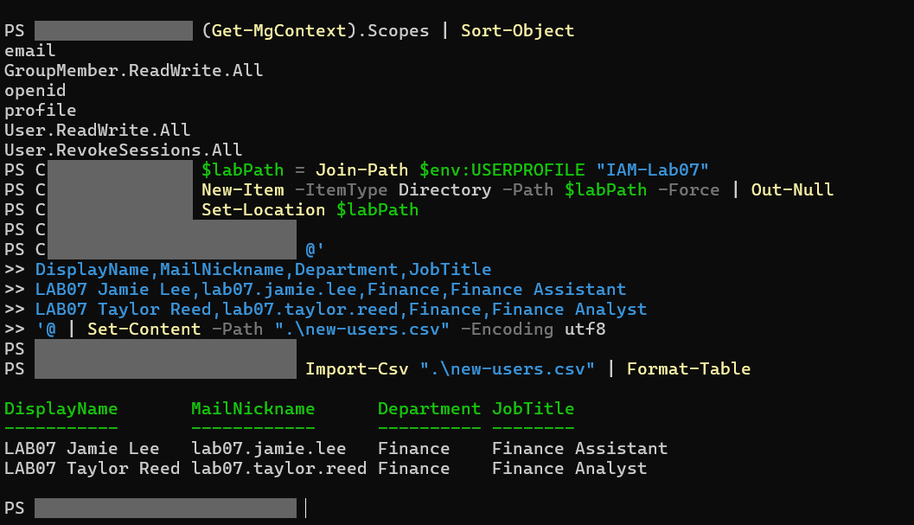

### Provisioning and enabled account read-back

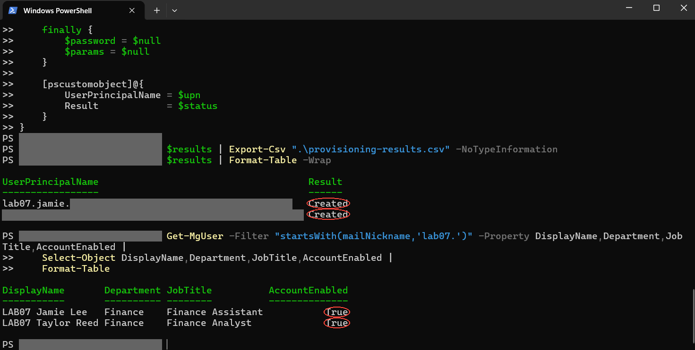

### LAB-Finance group inspected

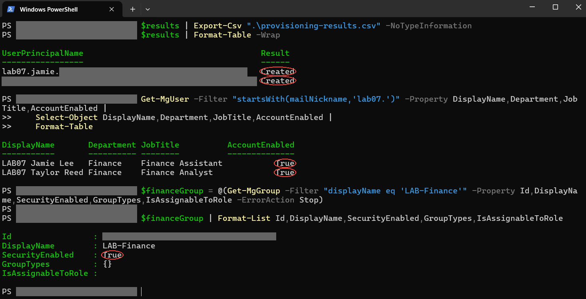

### Membership independently verified

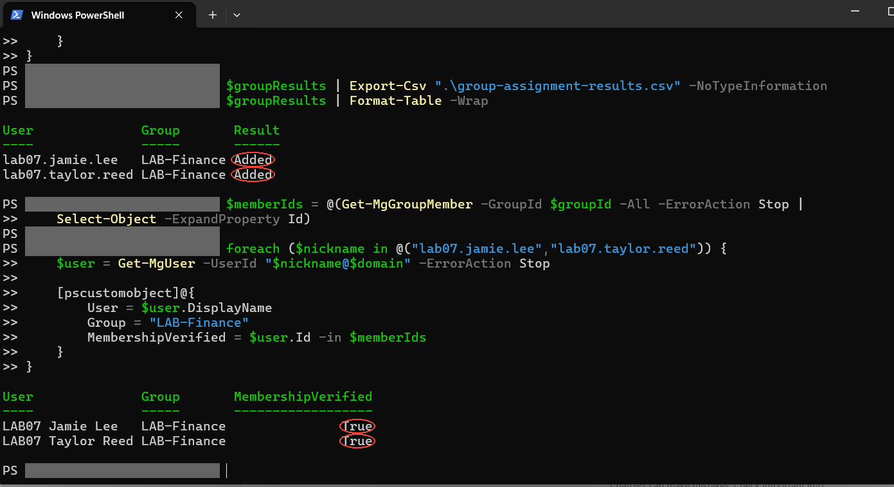

### Accounts disabled and session revocation requested

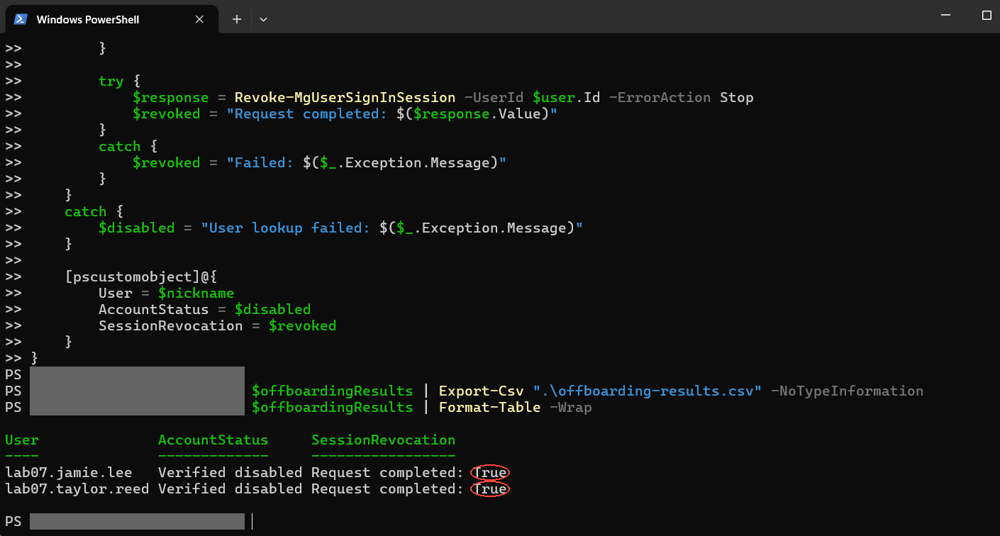

### Group membership removal verified

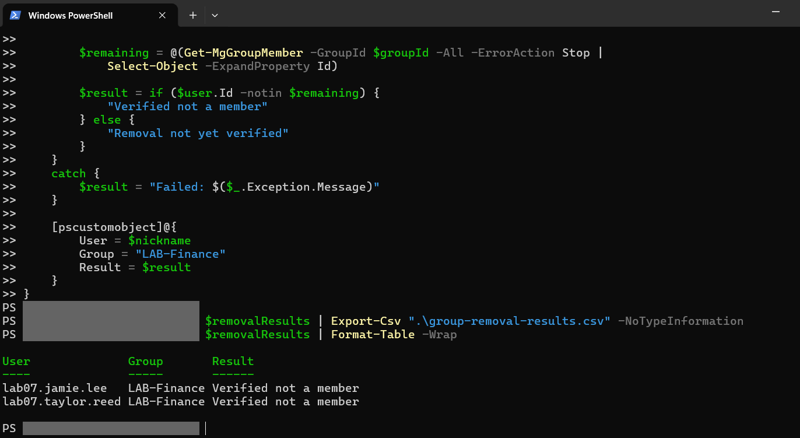

### Final validation

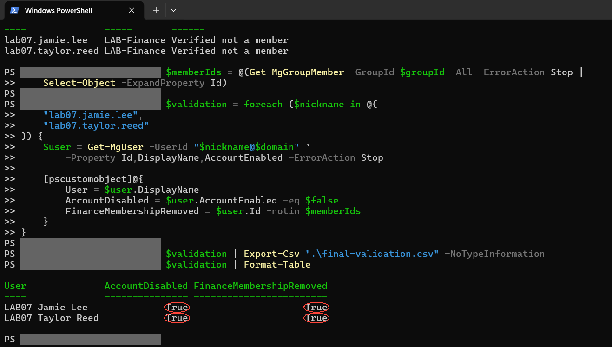

### Final validation and disconnect

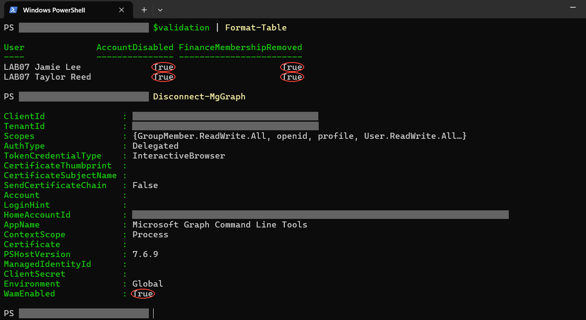

## Portal confirmation after offboarding

The portal screenshots additionally show the two test accounts in the directory. Each user overview displays **Disabled** and **0 group memberships**. The user list alone does not prove account state.


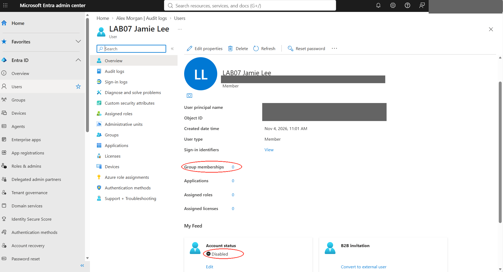


## Files and reproducibility

- `new-users.csv`: the two-row input demonstrated in the screenshots.
- `Lab07.ps1`: a parameterized adaptation of the commands used interactively. It includes user and group guards and runs one stage at a time. The packaged `.ps1` itself has not been live-run against the tenant.
- `screenshots/`: all supplied Lab 07 screenshots, redacted and annotated.
- `screenshot-index.json`: capture time to public filename mapping.

The actual exported CSV reports remain on the lab computer in `IAM-Lab07`; they are not fabricated or included here. Observed exports were `provisioning-results.csv`, `group-assignment-results.csv`, `offboarding-results.csv`, `group-removal-results.csv`, and `final-validation.csv`. Review and redact them before publishing. The packaged script uses stage-based report filenames.

## Run in a test tenant

Install dependencies in PowerShell 7:

```powershell
Install-Module -Name Microsoft.Graph.Authentication,Microsoft.Graph.Users,Microsoft.Graph.Groups,Microsoft.Graph.Users.Actions -Scope CurrentUser -Repository PSGallery
```

Review the script and CSV. Supply your own test tenant domain and the ID of an existing static LAB-Finance security group. Verify that the group grants no production access.

```powershell
$lab = @{
    TenantId = Read-Host 'Test tenant ID'
    Domain   = Read-Host 'Verified test tenant domain'
    GroupId  = Read-Host 'LAB-Finance group ID'
}
.\Lab07.ps1 -Stage Provision @lab
.\Lab07.ps1 -Stage AssignGroup @lab
# Inspect the users and group before continuing.
.\Lab07.ps1 -Stage Offboard @lab
.\Lab07.ps1 -Stage RemoveGroup @lab
.\Lab07.ps1 -Stage Validate @lab
Disconnect-MgGraph
```

Provisioning generates temporary passwords without printing or exporting them; this exercise does not distribute credentials or test user sign-ins. Setting password variables to null releases references and does not guarantee secure memory erasure. Existing users are skipped at provisioning; repeat-run behavior was not demonstrated in the screenshots.

## Troubleshooting and evidence limits

- Windows PowerShell 5.1 remained the original terminal host; launching `pwsh` and checking `$PSVersionTable.PSVersion` confirmed the running PowerShell 7 process.
- An assumed Program Files executable path did not exist. `where.exe pwsh` located the installed executable alias.
- An unanswered PSGallery prompt declined installation. Re-running and entering `A` at the actual prompt completed installation.
- Initial authentication attempts failed or were canceled. A later tenant-specific sign-in succeeded. The screenshots do not establish a defect in WAM.
- The `/me` output showed an external-style UPN; it verified the signed-in identity, not an administrative role.
- A successful session-revocation response confirms the API request, not observation of an active session terminating. No active test-user sessions were established in the evidence.
- Final validation checks disabled account state and removal from this one group. It does not establish removal of all possible access or revocation of every already-issued access token.
- No user sign-in test or audit-log review was captured in this lab.
- This is CSV-driven administrative automation, without SCIM, HR integration, scheduling, or unattended app authentication.
- Accounts were retained disabled for evidence; they were not deleted.

## Skills demonstrated

CSV processing, Microsoft Graph delegated authentication, scoped permissions, bulk user provisioning, security group membership management, account disabling, session-revocation requests, error handling, CSV report exports, and independent read-back verification.

## Add to the portfolio directory

Copy this folder into the repository root and add this row to the main README:

```markdown
| 07 | [PowerShell IAM Automation](Lab-07-PowerShell-IAM-Automation/) | CSV-based provisioning, group membership, account disabling, session-revocation requests, and validation with Microsoft Graph PowerShell |
```

## Microsoft documentation

- [Microsoft Graph PowerShell installation](https://learn.microsoft.com/powershell/microsoftgraph/installation)
- [Connect-MgGraph](https://learn.microsoft.com/powershell/module/microsoft.graph.authentication/connect-mggraph)
- [Create a user](https://learn.microsoft.com/graph/api/user-post-users)
- [Add a group member reference](https://learn.microsoft.com/powershell/module/microsoft.graph.groups/new-mggroupmemberbyref)
- [Revoke sign-in sessions](https://learn.microsoft.com/powershell/module/microsoft.graph.users.actions/revoke-mgusersigninsession)
- [Remove a group member reference](https://learn.microsoft.com/powershell/module/microsoft.graph.groups/remove-mggroupmemberdirectoryobjectbyref)
