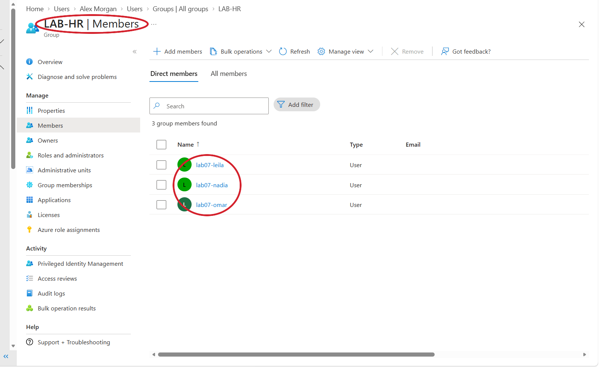
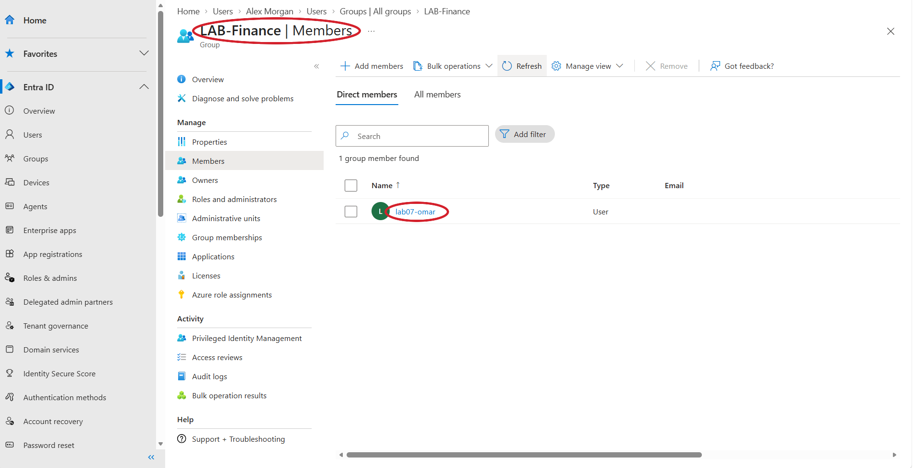
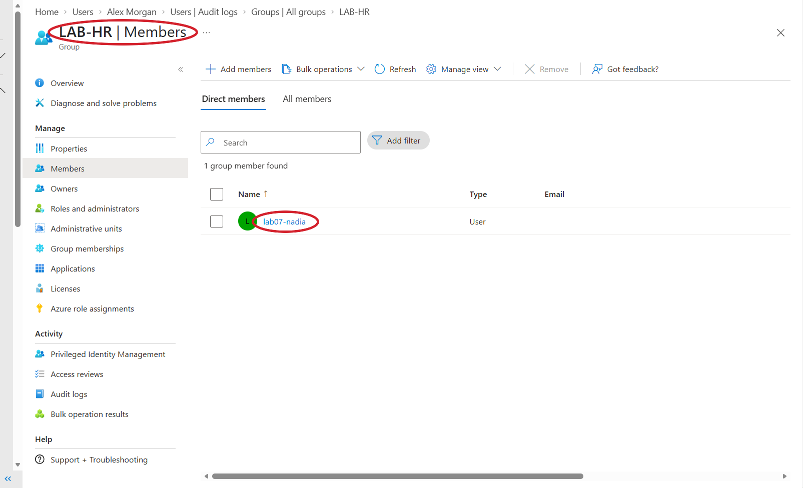
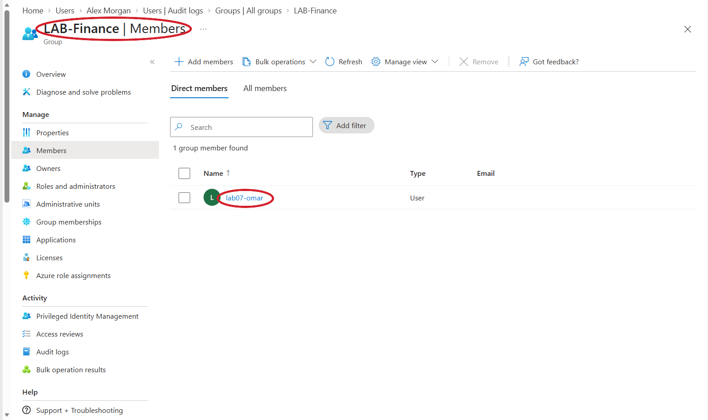
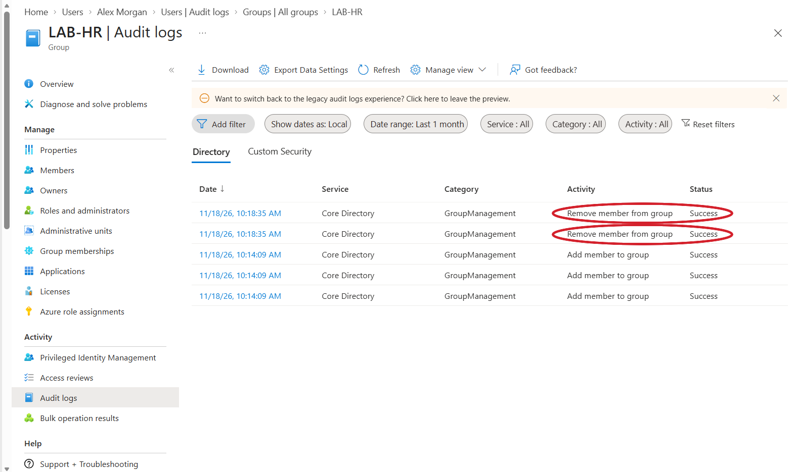
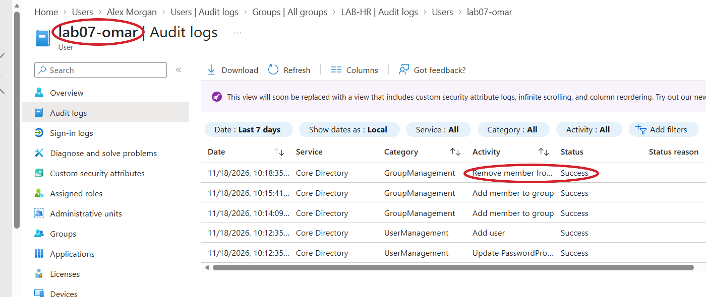
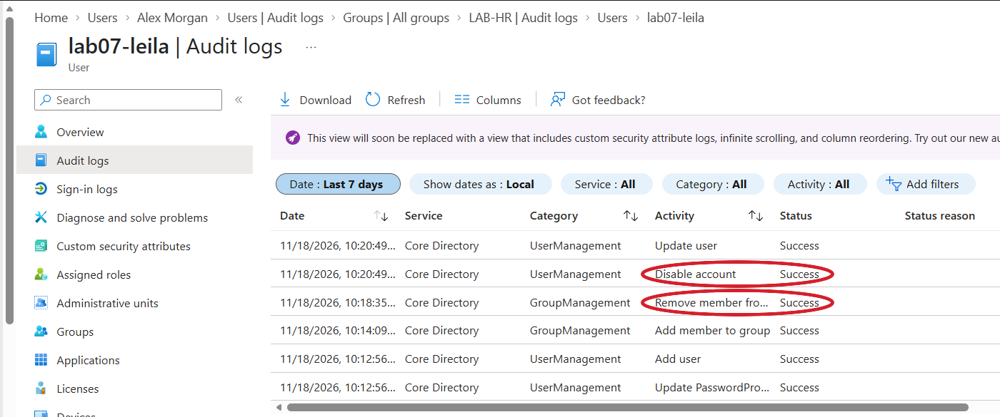

# Lab 08 — Microsoft Entra ID Access Review and Least Privilege Audit

I conducted a manual access review in my Microsoft Entra ID lab tenant. I compared direct security group memberships with approved access for three test users, removed two unnecessary HR memberships, and verified the results using group membership lists and audit logs.

## Review results

| Test user | Approved access | Observed before | Decision and verified outcome |
| --- | --- | --- | --- |
| Nadia | LAB-HR | LAB-HR | Retained HR access. Nadia was the only direct member of LAB-HR after the review. |
| Omar | LAB-Finance | LAB-HR and LAB-Finance | Removed the old HR membership after a simulated transfer. Verified that Omar remained a direct member of LAB-Finance. |
| Leila | None | LAB-HR | Removed the HR membership after a simulated separation. Entra recorded a successful account disablement. |

## Evidence

### HR before the review

Nadia, Omar, and Leila were direct members.

### Finance before the review

Omar was a direct member.

### HR after the review

Nadia was the only remaining direct member.

### Finance after the review

Omar kept his approved membership.

### HR group audit log

Two successful group member removals.

### Omar’s user audit log

Successful group member removal on Omar’s account.

### Leila’s user audit log

Successful group member removal and account disablement.

The test usernames retain their original `lab07-` prefix in the screenshots. The portfolio entry is numbered Lab 08.
